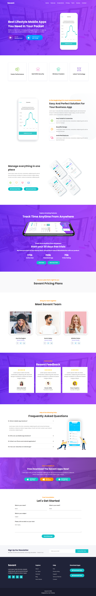

# Savant

Savant is a responsive, single-page landing template for a mobile app. It is built with HTML, Bootstrap 3 and custom SCSS/CSS.



## Sections

The page in `index.html` includes:

- Hero banner: "Best Lifestyle Mobile Apps You Need in Your Pocket"
- Highlights: Faster Performance, Build With Security, Wireless Freedom, Latest Technology
- Overview: easy install and customize, beautiful design, unlimited features
- Explore Amazing Features, with counters for active users, downloads and ratings
- Pricing plans: "Choose a Plan That's Right for You"
- Team
- Testimonials
- FAQs
- App store download buttons (Apple and Google)
- Free consultation / contact form

## Tech stack

- HTML5
- [Bootstrap 3](https://getbootstrap.com/docs/3.4/) for layout and components
- jQuery
- Font Awesome for icons
- Poppins font (see `Font-family.txt`)
- SCSS compiled to CSS (`css/style.scss`, `css/style.css`)

## Project structure

```
savant/
├── index.html          Main page
├── css/
│   ├── style.scss      Custom styles (source)
│   ├── style.css       Compiled styles used by the page
│   ├── bootstrap.min.css
│   └── font-awesome.css
├── JS/                 jQuery and Bootstrap scripts
├── fonts/              Poppins and Font Awesome font files
├── images/             Backgrounds, icons, team and testimonial photos
└── Template.png        Template preview
```

## Getting started

No build step is needed to view the page. Open `index.html` in a browser, or serve the folder locally:

```
npx serve .
```

To change the styles, edit `css/style.scss` and recompile it to `css/style.css`. For example, with the Sass CLI:

```
sass css/style.scss css/style.css
```

## Notes

- `index.html` references scripts at `js/...` but the folder is named `JS`. This works on Windows but breaks on case-sensitive hosts such as Linux and GitHub Pages. Rename the folder to `js` to fix it.
- `css/style - Copy.css` is a leftover backup and can be deleted.
